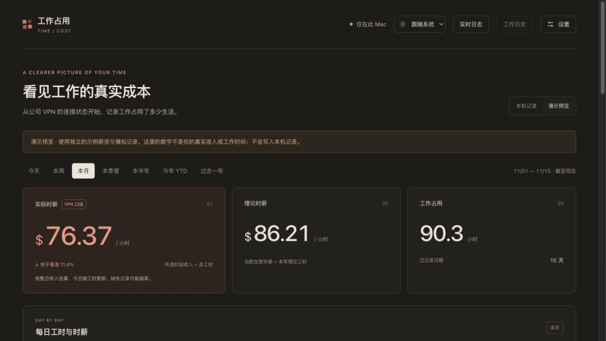

# Hourly Rate / 工作占用

[简体中文](README.md) | English

**“I don't think I worked that much this week.” The data would like a word.**

In the age of AI, are we working less, or fitting more work into the same hours? Feelings can be surprisingly bad at answering that. This little project tracks an estimate of the time work takes up and asks: **what does a fixed salary look like when divided by those hours?**

Turn “I think I've been a bit busy” into numbers you can inspect for yourself. Whether you make a cup of coffee afterwards is entirely up to you. ☕

> A local-first macOS side project, currently launched by a script and viewed in a browser—not a packaged Mac app. Demo data is separate from your records. **VPN connection is only a signal:** connected does not necessarily mean working, and disconnected does not necessarily mean resting.

## Take a look

Open **`preview.html`** in the project folder, or launch the application and select **Demo**. The preview uses fictional data and does not write to your records.

The interface supports English and Simplified Chinese. Choose a language at the top of the page, or follow the system language. Language selection does not change your currency, time zone or work-time rules.



*The application in demo mode. All numbers are fictional.*

Ready to track your own time? From the [GitHub repository](https://github.com/TCoherence/hourly-rate-tracker), choose **Code → Download ZIP** and extract it, or run `git clone https://github.com/TCoherence/hourly-rate-tracker.git`. Then:

1. Use **macOS and Python 3.10 or newer**. The application uses the Python standard library; no `pip install` is needed.
2. Double-click **`start-hourly-rate.command`** to open your local dashboard.
3. In Settings, enter your annual salary, currency and theoretical hours per working day. Add effective dates for salary changes.
4. For automatic tracking, choose an available VPN status source and enable tracking. You can also add or correct entries in Work History.
5. Closing the browser leaves the background service running. Double-click **`stop-hourly-rate.command`** to stop it.

The app supports macOS system VPN services and a user-supplied local status script; compatibility depends on the VPN client and machine. Collection is **off by default**, and the app does not connect or disconnect your VPN. If you use a script, supply a trusted executable that prints one line: `connected`, `disconnected` or `unknown`. Failure, timeout or invalid output is treated as unknown, not as a disconnection. The script runs with your user permissions, so only use one you trust. See the [status-script guide (Chinese)](docs/USER_GUIDE.md#本机状态脚本) for details.

Personal adapters can live under `adapters/` in the local data directory, outside the source tree. SQLite and JSON backups do not include adapter scripts or local legacy mappings; set these up separately when moving to a new machine. Backups with older source identifiers may also require a corresponding local compatibility mapping.

You can optionally enable launch at macOS login in Settings. Browser authorization is separate for each browser: the local launch entry authorizes it, and Settings can extend the current browser's 14-day authorization without restarting the service. To open the entry in another installed browser, run, for example, `python3 launcher.py --browser-app "Google Chrome"`, replacing the application name as needed. Do not share the launch link.

## What can it show me?

- **A timeline.** The app observes the local VPN connection state. Failed checks and unconfirmed sampling gaps remain unknown; they are not guessed to be work or rest.
- **A work-history calendar.** Inspect sources, add or correct entries, split a work period, or merge adjacent periods. Merging across a gap prompts before the extra time is counted. An interval being automatically tracked is protected while active.
- **Two hourly rates.** The theoretical rate uses annual salary and theoretical working time. The actual rate divides the income allocated to the selected period by recorded work hours. For an individual day with less than one hour of work, the rate uses a one-hour minimum without altering the recorded time; weekly and monthly calculations use actual total hours. Today, this week and this month can be compared with the preceding complete period. Salary changes are applied by effective date.
- **Charts.** Explore daily work hours, hourly-rate trends and a heatmap focused on recent months. Light, dark and system themes are available.
- **Display privacy controls.** Hide salary, rates, amounts and percentages independently from work hours and specific times. Dates, trends and calendar colors remain visible. These controls affect the current browser's display, not the stored data or exports.
- **Local backups.** Export a SQLite snapshot for backup and restore, readable JSON, or daily summary CSV.
- **Screen-sleep reminders.** If all online displays appear asleep while VPN time is still being counted, the app can mark a long interval for review. The default threshold is four hours. It only reminds you; it does not automatically deduct time.

There's also a little vector donkey on the dashboard keeping you company. It settles down when your system requests reduced motion. No keystroke counting, window surveillance or “productivity score”: you decide what work and rest mean.

## A completely fictional example

Suppose a working day is allocated **$800** in fixed income and you record **8 hours**:

```text
Actual hourly rate = $800 ÷ 8 hours = $100/hour
```

Then you record another 2 hours over a weekend that is not configured as a theoretical working day. No extra fixed daily income is allocated for that weekend:

```text
Actual hourly rate = $800 ÷ (8 + 2) hours = $80/hour
```


*A conceptual illustration using fictional numbers, not a recording of the app.*

Viewed on its own, a non-working day with recorded work has **0** allocated daily income and an actual rate of **0**. That's a consequence of this project's fixed-salary allocation model, not a valuation of weekend work. It is not a formal payroll, tax or labor-compensation calculation. See the [calculation details (Chinese)](docs/USER_GUIDE.md#如何计算).

## Where does the data go?

By default, it stays in `~/Library/Application Support/HourlyRateMVP/`:

```text
VPN status → local samples → local SQLite → local dashboard
```

Salary, work history and corrections are stored on your Mac. The service listens on the local machine; there are currently **no accounts, cloud sync or automatic uploads**. Closing the browser does not delete settings or records. The app does not read chat, code, screenshots or VPN traffic data.

Local does not mean invisible to everyone: other processes under the same account, administrators and device backups may be able to read the files. The database has no additional application-level encryption. Check screenshots, exports and logs before sharing them.

## A few important caveats

- **VPN connected ≠ working.** You may leave it connected while eating, and meetings, offline work or work on another device may not be captured. Treat results as estimates and correct them in the calendar.
- **Screen off ≠ Mac asleep.** If the Mac stays awake and the VPN remains connected, tracking can continue. System sleep is excluded by default, but closing the lid does not necessarily put every Mac to sleep.
- **A screen-sleep reminder does not decide that you were resting.** It relies on sampled display states; brief wake-ups between samples can be missed. Multi-display, mirrored-display and closed-lid cases have not yet been verified on physical hardware. The app cannot reconstruct display state before monitoring starts and does not alert for unconfirmed periods.
- **Nightly automatic pause is optional.** Configure a start and end time to exclude automatic VPN work in that interval; automatic counting resumes afterwards. Manual records can still be counted. Changing this rule recalculates history.
- **Manual pause stays on until you resume.** VPN status may still be checked, but automatically observed time is not counted while paused. The pause survives a restart, and nightly rules still apply.
- **Missing data can inflate the rate.** The app allocates a full daily salary to recorded theoretical workdays and divides the period's total income by its total work hours. Non-working days add hours without adding fixed income.
- **This is a personal observation tool**, not an attendance system or a way to monitor, rank or evaluate other people.

## Development and testing

```sh
# Start the local service, or double-click start-hourly-rate.command
python3 launcher.py

# Python regression tests
python3 -m unittest discover -s tests -v

# Frontend interaction and privacy tests (requires Node.js)
node --test tests/*.cjs

# Rebuild the offline preview using fictional data only
python3 build_preview.py
```

Automated tests use temporary directories and mock status sources. They do not connect or disconnect your VPN. The more detailed [user and calculation guide](docs/USER_GUIDE.md), [contribution guide](CONTRIBUTING.md), [release and privacy checklist](OPEN_SOURCE.md) and [future ideas](TODO.md) are currently in Chinese.

## What next?

First, make the local experience good. A menu-bar Mac app, better ways to review uncertain periods and holiday rules are on the idea list. A voluntary aggregate view inspired by levels.fyi is only an idea: **there is no website or data collection**. Any such work would need careful privacy and sampling design first.

These numbers are a way to observe your work and life. Your hourly rate is a reference, not your price as a person.

## Project status

This side project is still being refined and uses the [MIT License](LICENSE). The [release and privacy checklist](OPEN_SOURCE.md) records considerations for preparing and publishing the project.
