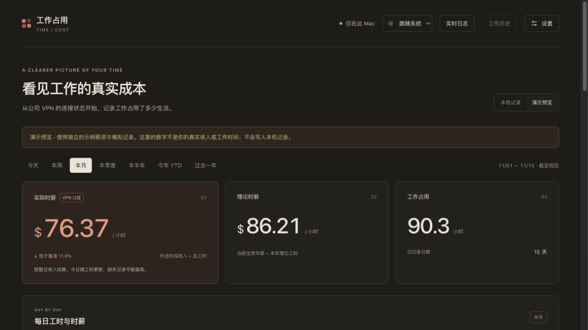
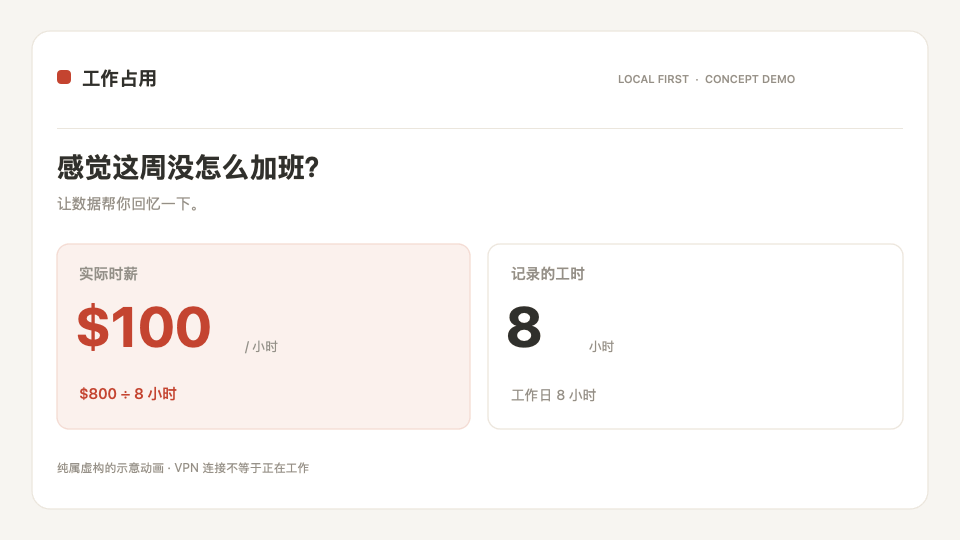

# 工作占用 / Hourly Rate

简体中文 | [English](README.en.md)

**感觉这周没怎么加班。数据：要不你再想想？**

AI 时代，工作变轻松了，还是同样的时间里干了更多事情？很难只凭感觉回答。所以我们做了一个小工具：**记录工作占用的时间，再看看固定薪资摊下来大约是多少时薪。**

把「好像有点忙」变成几个可以自己检查的数字。看完之后，要不要给自己泡杯咖啡，由你决定。☕

> 这是一个本地优先的 macOS side project，当前用脚本启动，在浏览器里查看；不是打包好的 Mac app。演示数据和真实数据分开。**VPN 连接只是工作占用的一个信号，连接着不一定在工作，断开了也可能在工作。**

## 给我看看

想先逛逛？打开仓库里的 **`preview.html`**，或启动应用后点「演示预览」。演示只使用虚构数据，不会写入你的记录。

界面支持简体中文和英语，可在顶部切换，也可跟随系统语言。语言选择不会改变币种、时区或工时规则。



*实际界面的演示模式，所有数字均为模拟数据。*

想记录自己的时间？先从 [GitHub 仓库](https://github.com/TCoherence/hourly-rate-tracker)选择 **Code → Download ZIP** 并解压，或运行 `git clone https://github.com/TCoherence/hourly-rate-tracker.git` 获取项目，然后：

1. 准备 **macOS 和 Python 3.10+**。运行时只使用 Python 标准库，无需 `pip install`。
2. 双击 **`start-hourly-rate.command`**，打开本机仪表盘。
3. 在「设置」里填写年薪、币种和每日理论工时。调薪可以添加新的生效日期。
4. 要自动记录，选择可用的 VPN 来源并启用本机计时；也可以在「工作历史」中手动填写或修正。
5. 关闭浏览器后后台仍会运行；双击 **`stop-hourly-rate.command`** 才会停止。

支持系统 VPN 以及自行配置的本机状态脚本；具体支持情况取决于你的客户端和机器。默认不会开启采集，也不会代替你连接或断开 VPN。脚本只需按约定返回状态，具体适配由你自己管理，见 [状态来源说明](docs/USER_GUIDE.md#本机状态脚本)。

个人适配脚本可以放在数据目录下的 `adapters/` 中，与项目源码分开。SQLite 和 JSON 导出不包含脚本或本机旧版兼容映射；更换电脑时需要自行重新配置。使用旧来源标识的备份也需要相应的本机兼容映射才能恢复。

可在设置中选择登录后自动启动；关闭此选项不影响当前正在进行的记录。详细操作和故障排查见 [使用与计算说明](docs/USER_GUIDE.md)。

不同浏览器分别授权；打开本机入口后可在设置中查看并延长当前浏览器的 14 天授权，不需要重启服务。需要用其他系统浏览器时，可在项目目录运行 `python3 launcher.py --browser-app "Google Chrome"`，将名称替换为本机浏览器名称。

## 它会记录什么？

- **一个时间线**：读取本机 VPN 的连接状态。失败、无法读取或长时间缺采样会显示为未知，不假装你在工作或者休息。
- **一张日历**：按天查看工时、手动调整和数据来源。可拆分工作时段，或合并相邻时段；有间隔时会先提示新增工时。正在自动记录的时段会保护起来；结束后可以修正。
- **两个时薪**：理论时薪用年薪和理论工作时间计算；实际时薪用所选时段分配的收入除以记录的实际工时。单日有工时但不足 1 小时时，时薪按 1 小时估算，工时记录不变；周月仍使用真实总工时。今天、本周、本月还可与上一个完整周期对比。收入随调薪生效日期重新计算。
- **一些图**：每天的工作时长、时薪趋势，以及以最近几个月为中心的热力图。浅色、深色和跟随系统都支持。
- **数字与时间显示开关**：在共享环境中可以分别隐藏薪资、时薪、金额和百分比，或隐藏工时与具体时段，同时保留日期、曲线和日历色块。隐藏只影响当前浏览器的显示，不改变本机记录或导出的真实数据。
- **本机备份**：SQLite 快照适合完整备份与恢复；也可导出可读的 JSON 或每日汇总 CSV。
- **熄屏提醒**：屏幕长时间休眠、VPN 仍在计时的时候，请你确认那段时间；默认 4 小时，只提醒，不自动扣除工时。

首页还有一只陪你工作的矢量小驴；系统开启“减少动态效果”时，它会安静下来。工具不会根据你按了多少键、开了多少窗口或者看起来有多忙来给你打绩效分。休息和边界由你自己定义。

## 一个完全虚构的例子

假设某工作日分配到的固定收入是 **$800**，记录工作 **8 小时**：

```text
实际时薪 = $800 ÷ 8 小时 = $100/小时
```

如果同一周期的周末又记录了 2 小时，而周末不是设置里的理论工作日，不另外分配日薪：

```text
实际时薪 = $800 ÷ (8 + 2) 小时 = $80/小时
```



*虚构数字的概念动画，用来说明计算方式，并非软件录屏。*

单独查看有工时的非理论工作日时，其当天分配收入和实际时薪会显示为 **0**。这是本项目的固定薪资分摊方式，不是在给周末劳动定价；也不是薪资、税务或劳动报酬的正式计算。详情见[计算口径](docs/USER_GUIDE.md#如何计算)。

## 数据去哪儿了？

默认路径：`~/Library/Application Support/HourlyRateMVP/`。

```text
VPN 状态 → 本机采样 → 本机 SQLite → 本机仪表盘
```

薪资、工时和手动修正保存在你的 Mac。服务只监听本机地址，当前没有账号、云端同步或自动上传；状态和设置不会因为关闭浏览器而丢失。工具不读取你的聊天、代码、屏幕截图或 VPN 节点流量数据。

这些信息依然很私人：同一账户、管理员或设备备份可能读取本地文件。数据库没有额外的应用层加密；分享截图、导出或日志前，请先看看里面有什么。

## 有几个很重要的「但是」

- **VPN 已连接 ≠ 正在工作**。出门吃饭时 VPN 可能还开着；开会、离线工作或手机工作也可能没有被记录。结果是估算，支持在日历里修正。
- **熄屏 ≠ 整机睡眠**。Mac 没有睡眠且 VPN 仍连接时会继续计时。默认排除系统睡眠，但合盖不一定会让机器睡眠。
- **熄屏提醒不是自动判定休息**。它按采样判断所有在线显示器是否休眠；采样之间短暂亮屏可能漏过，多屏和合盖场景尚未实机验证。程序启动前的屏幕状态无法回溯，不能确认的时段不触发提醒。
- **夜间自动暂停是可选规则**。设置开始和结束时间后，该时段的自动 VPN 工时不计入，到点后自动恢复；手动记录仍可计入。修改规则会重新计算历史。
- **随时手动暂停或恢复**。暂停后仍会检测 VPN，但暂停时段不计入自动工时；重启后保持暂停，直到你主动恢复。夜间暂停规则仍然生效，也可以在工作历史中修正。
- **记录不完整会影响时薪**。目前按有记录的理论工作日分配整日日薪，再用所选周期总收入除以总工时；缺失工时可能让结果偏高。非理论工作日只增加工时，不另加固定收入。
- **这是个人观察工具**，不是考勤系统，也不适合用来监控、排名或替别人做绩效判断。

## 开发与测试

```sh
# 启动本机服务；也可以双击 start-hourly-rate.command
python3 launcher.py

# Python 回归测试
python3 -m unittest discover -s tests -v

# 前端交互和隐私显示测试（需要 Node.js）
node --test tests/*.cjs

# 使用纯模拟数据重新生成离线演示
python3 build_preview.py
```

自动测试使用临时目录和模拟检测器，不会主动连接或断开 VPN。开发结构、数据路径、日志、计算细节和运行选项见 [使用与计算说明](docs/USER_GUIDE.md)；参与改进前可参考[贡献指南](CONTRIBUTING.md)。

## 然后呢？

先把本机体验做好。菜单栏 Mac app、更完善的不确定时段确认、节假日规则等想法放在 [TODO](TODO.md)。也想过有一天做一个类似 levels.fyi 的自愿聚合视图；这目前只是想法，**没有网站或数据收集**，要真正做之前还需要认真设计隐私和样本口径。

希望这些数字能帮你观察自己的工作与生活。时薪是一个参考，不是你这个人的价格。

## 项目状态

这是一个仍在打磨的 side project，采用 [MIT 许可证](LICENSE)。[发布与隐私检查](OPEN_SOURCE.md)列出了整理和发布时需要关注的事项。
